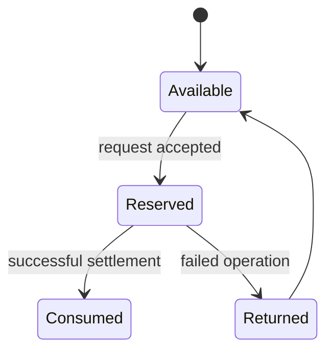
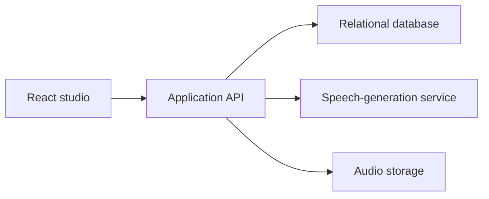
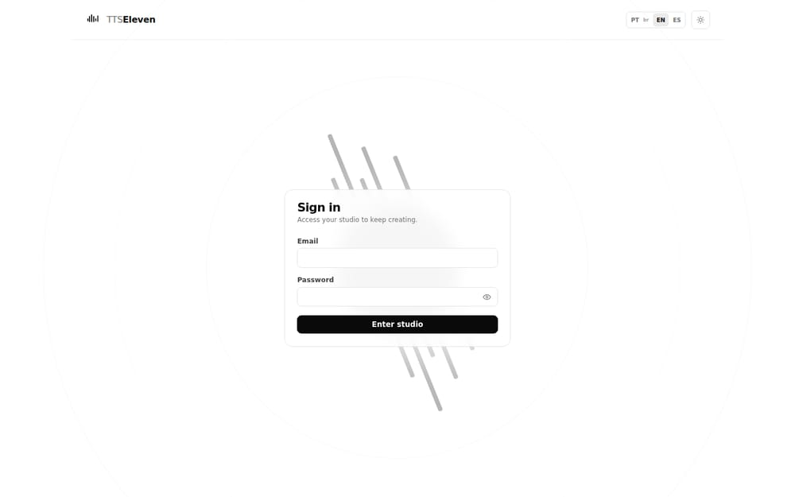

# TTSELEVEN

**An independently operated text-to-speech product, from generation request to downloadable audio.**

[Open the application](https://ttseleven.vercel.app) · [All projects](https://github.com/alissonramosz/ai-product-portfolio)

| Role | Stage | Focus |
| --- | --- | --- |
| Product owner, developer and operator | Live product; sales through third-party marketplaces | Applied AI, asynchronous jobs, usage credits and customer operations |

## Context

Generating speech is only one part of running a voice product. Customers also need to understand their balance, follow a request, retrieve the audio and know what happens when a generation fails.

TTSELEVEN brings those steps into a customer-facing studio backed by external speech-generation providers. I operate the product, develop its application workflows and integrations, and handle the practical requirements that appear after a customer starts using it.

## What I worked on

- **Voice-generation workflow:** text and voice settings, asynchronous processing, request status, audio playback and download.
- **Customer credits:** balance visibility and a reservation/settlement lifecycle around a generation, including failure handling.
- **Generation history:** keeping the operation record separate from the lifetime of its downloadable audio.
- **Provider integration:** connecting speech services behind the application's own generation experience.
- **Operations:** tracing a failed request and distinguishing synthesis problems from audio-transfer or storage problems.

## Product and engineering decisions

### Credits follow the operation, not just the button click

A submitted request is not yet a successful delivery. The credit workflow separates reservation from settlement and return, with safeguards against handling the same operation twice. Customer credits and provider usage are separate concerns.

*Simplified customer-credit lifecycle; not an infrastructure diagram.*

### History and media have different lifetimes

An expired download should not erase the record of what happened. The product retains generation history independently of audio retention, so a customer can still recognize an earlier operation after its media is no longer available.

### Operation needs more than a generic error

The request path distinguishes generation, transfer and storage failures. That distinction matters when deciding whether to investigate, retry or settle credits, rather than repeating a paid generation without understanding the first attempt.

## Real development problems and decisions

### Expiring audio was also removing useful history

**Problem:** media retention and generation history had been treated as the same lifecycle. Removing an old audio file could also remove the record a customer needed to understand a past operation.

**Decision and implementation:** separate the two lifecycles. Retain the generation record, expire access to the audio in both the API and interface, and make cleanup remove the media rather than the history. Media expiry does not change a completed job into a failure or undo its settled credits.

**Resulting behavior:** an expired download is shown as expired while the operation remains in history. Cleanup is not the access-control mechanism: the application also checks expiry when serving audio.

### A generic audio error was not enough to decide what to retry

**Problem:** a synthesis failure, an interrupted transfer and a storage failure could appear to the customer as a failed audio operation, but they need different investigation and credit decisions. Repeating synthesis just to diagnose the problem can incur another provider charge.

**Decision and implementation:** correlate diagnostic information with the operation and the processing step, preserve the original cause where available, and keep customer text, audio and credentials out of the diagnostic record.

**Resulting behavior:** support can investigate the recorded failure before deciding to repeat a paid operation. If the available evidence is incomplete, the report identifies that gap rather than attributing a cause it cannot establish.

## Current delivery

The application is running and sold through GGMAX and DFG. Checkout inside the application is a future improvement, not part of the current delivery. Speech models are supplied by external providers; my work is the product, integration and operation around them.

## Technical implementation

| Layer | Technology | Responsibility |
| --- | --- | --- |
| Customer studio | React, JavaScript, Vite | Text input, generation state, audio playback and history |
| Application services | Node.js, Express | Customer-facing APIs and asynchronous speech-service integration |
| Relational data | PostgreSQL, Sequelize | Customer credits, generation records and transactional state changes |
| Media | Object storage | Downloadable audio with a lifetime separate from the generation record |

*A conceptual component view, not the deployment topology or provider configuration.*

Database work includes transactional changes around credit reservation and settlement. Separating the operation record from its audio also makes retention a media concern rather than deletion of the customer's history.

[Development workflow](https://github.com/alissonramosz/ai-product-portfolio#development-workflow)

## Public access

[TTSELEVEN](https://ttseleven.vercel.app) opens the real application; customer features require an account.

  

Public sign-in page, captured on 23 November 2026. Customer features require an account and are not shown.

This repository contains the public case study. Application source, customer material and commercial provider details remain private.
