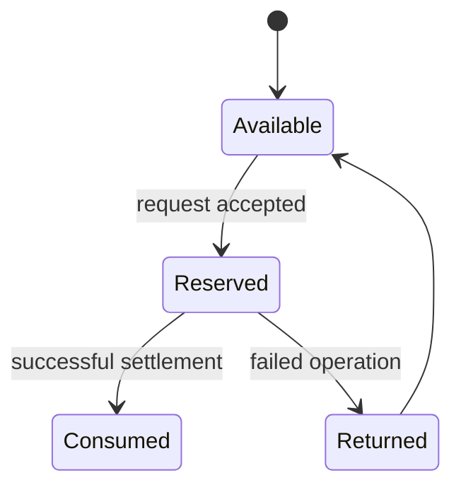

# TTSELEVEN

**An independently operated text-to-speech product, from generation request to downloadable audio.**

[Open the application](https://ttseleven.vercel.app) · [All projects](https://github.com/alisson539/ai-product-portfolio)

| Role | Stage | Focus |
| --- | --- | --- |
| Product owner, developer and operator | Live product; sales through third-party marketplaces | Applied AI, asynchronous jobs, usage credits and customer operations |

## Context

Generating speech is only one part of running a voice product. Customers also need to understand their balance, follow a request, retrieve the audio and know what happens when a generation fails.

TTSELEVEN brings those steps into a customer-facing studio backed by external speech-generation providers. I operate the product, develop its application workflows and integrations, and handle the practical requirements that appear after a customer starts using it.

## What I worked on

- **Voice-generation workflow:** text and voice settings, asynchronous processing, request status, audio playback and download.
- **Customer credits:** balance visibility and a reservation/settlement lifecycle around a generation, including failure handling.
- **Generation history:** keeping the operation record separate from the lifetime of its downloadable audio.
- **Provider integration:** connecting speech services behind the application's own generation experience.
- **Operations:** tracing a failed request and distinguishing synthesis problems from audio-transfer or storage problems.

## Product and engineering decisions

### Credits follow the operation, not just the button click

A submitted request is not yet a successful delivery. The credit workflow separates reservation from settlement and return, with safeguards against handling the same operation twice. Customer credits and provider usage are separate concerns.

*Simplified customer-credit lifecycle; not an infrastructure diagram.*

### History and media have different lifetimes

An expired download should not erase the record of what happened. The product retains generation history independently of audio retention, so a customer can still recognize an earlier operation after its media is no longer available.

### Operation needs more than a generic error

The request path distinguishes generation, transfer and storage failures. That distinction matters when deciding whether to investigate, retry or settle credits, rather than repeating a paid generation without understanding the first attempt.

## Current delivery

The application is running and sold through GGMAX and DFG. Checkout inside the application is a future improvement, not part of the current delivery. Speech models are supplied by external providers; my work is the product, integration and operation around them.

**Technology:** React, JavaScript, Vite, Node.js, Express, PostgreSQL and object storage.

## Public access

[TTSELEVEN](https://ttseleven.vercel.app) opens the real application; customer features require an account.

This repository contains the public case study. Application source, customer material and commercial provider details remain private.
